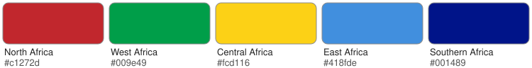

# Region colours report

> **Status: approved on 2026-10-22.** These are the colours the app uses (`reference/region_colors_approval.json`), with the owner's adjustments below.
>
> **Adjusted:** Western Africa uses `#55d27a` instead of the computed `#009e49`. Lightened on the owner's instruction (2026-10-22) so Western Africa stands apart from Eastern Africa's green: same OKLCH hue and chroma, lightness 0.61 to 0.77. CIEDE2000 to Eastern Africa rises from 20.4 to 36.4 (at least 33.4 to every region); simulated colour-vision-deficiency difference at least 10.8; contrast 1.69:1 on the light page.

Generated by `python -m pipelines flags` from the Flagpedia (flagcdn.com) SVGs of the 54 countries, fetched 2026-10-15. Colours are reported exactly as computed; any adjustment the owner approves is recorded in the approval file and named in the status above.

## Result

| Region | Pick (neutrals excluded) | Share of region | Pick if neutrals may win |
|---|---|---|---|
| Northern Africa |  `#c1272d` | 45.3% |  `#c1272d` (45.3%) |
| Western Africa |  `#009e49` | 17.6% |  `#009e49` (17.6%) |
| Central Africa |  `#fcd116` | 22.5% |  `#fcd116` (22.5%) |
| Eastern Africa |  `#006600` | 4.5% |  `#000000` (10.7%) |
| Southern Africa |  `#6da9d2` | 15.0% |  `#6da9d2` (15.0%) |

### Checks on the strict result

- **Issue:** Western Africa has no clear mode: its top colours #009e49 (17.6%) and #ce1126 (17.0%) are within 1 percentage point of each other.
- **Issue:** Eastern Africa's pick (#006600) is its #8 colour after the uniqueness rule: it covers 4.5% of the region's flag area and appears in 3 of 18 flags, so it represents the region weakly.
- **Issue:** With deuteranopia, Northern Africa and Western Africa look nearly the same (simulated ΔE 9.0); the legend and map need a non-colour cue.
- **Issue:** With protanopia, Northern Africa and Eastern Africa look nearly the same (simulated ΔE 10.0); the legend and map need a non-colour cue.
- **Issue:** Western Africa (#009e49) and Eastern Africa (#006600) differ by only ΔE 20.4; adjacent regions may be hard to tell apart on the map.
- **Issue:** Central Africa (#fcd116) has contrast 1.29:1 against the light page; country boundaries will need a stronger stroke there.

### Checks on the with-neutrals result

- **Issue:** Western Africa has no clear mode: its top colours #009e49 (17.6%) and #ce1126 (17.0%) are within 1 percentage point of each other.
- **Issue:** Eastern Africa's pick (#000000) is its #3 colour after the uniqueness rule: it covers 10.7% of the region's flag area and appears in 8 of 18 flags, so it represents the region weakly.
- **Issue:** Southern Africa has no clear mode: its top colours #6da9d2 (15.0%) and #ffffff (14.4%) are within 1 percentage point of each other.
- **Issue:** With deuteranopia, Northern Africa and Western Africa look nearly the same (simulated ΔE 9.0); the legend and map need a non-colour cue.
- **Issue:** Central Africa (#fcd116) has contrast 1.29:1 against the light page; country boundaries will need a stronger stroke there.
- **Issue:** Eastern Africa (#000000) has contrast 1.13:1 against the dark page; country boundaries will need a stronger stroke there.

Checks: picks closer than ΔE 30 (or ΔE 10 under simulated protanopia, deuteranopia or tritanopia) may be hard to tell apart; fills under 1.5:1 against a page background are hard to see; a pick demoted to its third colour or below, or covering under 10% of its region, represents the region weakly. Per the spec (§7.1), the dark theme may adjust a region colour's lightness and chroma in OKLCH (never its hue) where contrast is low; that is a display adjustment, not a change to these colours.

Pairwise CIEDE2000 differences between the strict picks:

| | Northern Africa | Western Africa | Central Africa | Eastern Africa | Southern Africa |
|---|---|---|---|---|---|
| **Northern Africa** | — | 71.7 | 56.4 | 65.7 | 53.1 |
| **Western Africa** | 71.7 | — | 39.1 | 20.4 | 41.9 |
| **Central Africa** | 56.4 | 39.1 | — | 50.4 | 54.2 |
| **Eastern Africa** | 65.7 | 20.4 | 50.4 | — | 53.2 |
| **Southern Africa** | 53.1 | 41.9 | 54.2 | 53.2 | — |

Contrast of each strict pick against the page backgrounds (WCAG ratio; map fills are outlined by boundary strokes, so this is a visibility guide, not a text-contrast rule):

| Region | light page | dark page |
|---|---|---|
| Northern Africa | 5.11:1 | 3.17:1 |
| Western Africa | 3.07:1 | 5.28:1 |
| Central Africa | 1.29:1 | 12.58:1 |
| Eastern Africa | 6.34:1 | 2.56:1 |
| Southern Africa | 2.23:1 | 7.28:1 |

## How it was computed

1. Each flag SVG was rasterised at 320px wide; only opaque pixels count.
2. Each flag was clustered into at most 8 colours (k-means in CIELAB over its distinct pixel colours, weighted by pixel count, fixed seed). Each cluster is represented by its most frequent exact pixel colour, so the hex values are the flags' own colours. Anti-aliasing blends were removed first: a colour under 3% of a flag lying within 12 RGB units of the line between two of the flag's main colours was folded into the nearer one, and any colour still under 0.5% into the nearest remaining colour.
3. Clusters were merged across all 54 flags when their CIEDE2000 difference was below 10 (largest clusters first; each joins the closest existing colour). A region's colour is shown in the shade most common in its own flags.
4. For each region, the pixel areas of each merged colour were summed across the region's flags; the largest total is the region's mode colour.
5. Neutral colours (CIELAB chroma below 10: whites, blacks, greys) are excluded from the ranking by default; the other result is reported too.
6. Uniqueness: while two regions' picks were the same merged colour or closer than ΔE 20, the region where that colour has the larger share kept it and the other moved to its next-ranked colour.

Every parameter is a command-line option (`python -m pipelines flags --help`).

### Uniqueness decisions: strict (neutrals excluded)

- east (#fcdc04, 12.1% of its flags' area) and central (#fcd116, 22.5%) are the same merged colour; central keeps its colour and east moves to #ce1126 (10.9%).
- east (#ce1126, 10.9% of its flags' area) and north (#c1272d, 45.3%) are the same merged colour; north keeps its colour and east moves to #43b02a (10.4%).
- east (#43b02a, 10.4% of its flags' area) and west (#009e49, 17.6%) are the same merged colour; west keeps its colour and east moves to #418fde (9.9%).
- east (#418fde, 9.9% of its flags' area) and southern (#6da9d2, 15.0%) are the same merged colour; southern keeps its colour and east moves to #fc3d32 (9.6%).
- east (#fc3d32, 9.6% of its flags' area) and north (#c1272d, 45.3%) are only ΔE 14.5 apart (< 20); north keeps its colour and east moves to #198a00 (7.0%).
- east (#198a00, 7.0% of its flags' area) and west (#009e49, 17.6%) are only ΔE 9.7 apart (< 20); west keeps its colour and east moves to #6ab2e7 (4.8%).
- east (#6ab2e7, 4.8% of its flags' area) and southern (#6da9d2, 15.0%) are only ΔE 3.4 apart (< 20); southern keeps its colour and east moves to #006600 (4.5%).

### Uniqueness decisions: with neutrals

- east (#fcdc04, 12.1% of its flags' area) and central (#fcd116, 22.5%) are the same merged colour; central keeps its colour and east moves to #ce1126 (10.9%).
- east (#ce1126, 10.9% of its flags' area) and north (#c1272d, 45.3%) are the same merged colour; north keeps its colour and east moves to #000000 (10.7%).

## Top candidates per region

Ranked by share of each region's total flag area (neutral colours included in the list and marked; the strict pick skips them).

### Northern Africa (6 flags)

Strict pick:

| Rank | Colour | Hex | Share of region | Neutral | Flags |
|---|---|---|---|---|---|
| 1 |  | `#c1272d` **← pick** | 45.3% |  | Algeria, Egypt, Morocco, Sudan, Tunisia |
| 2 |  | `#ffffff` | 19.6% | yes | Algeria, Egypt, Libya, Sudan, Tunisia |
| 3 |  | `#000000` | 16.7% | yes | Egypt, Libya, Sudan |
| 4 |  | `#006633` | 11.2% |  | Algeria, Morocco, Sudan |
| 5 |  | `#239e46` | 3.4% |  | Libya |

With neutrals the pick would be  `#c1272d` (45.3%).

### Western Africa (16 flags)

Strict pick:

| Rank | Colour | Hex | Share of region | Neutral | Flags |
|---|---|---|---|---|---|
| 1 |  | `#009e49` **← pick** | 17.6% |  | Burkina Faso, Côte d'Ivoire, Guinea-Bissau, Mali, Mauritania, Niger, Sierra Leone |
| 2 |  | `#ce1126` | 17.0% |  | Cabo Verde, Ghana, Guinea, The Gambia, Guinea-Bissau, Liberia, Mali, Mauritania, Togo |
| 3 |  | `#fcd116` | 14.4% |  | Benin, Burkina Faso, Cabo Verde, Ghana, Guinea, Guinea-Bissau, Mali, Mauritania, Senegal, Togo |
| 4 |  | `#ffffff` | 12.3% | yes | Côte d'Ivoire, Cabo Verde, The Gambia, Liberia, Niger, Nigeria, Sierra Leone, Togo |
| 5 |  | `#008751` | 10.3% |  | Benin, Guinea, Nigeria, Senegal |

With neutrals the pick would be  `#009e49` (17.6%).

### Central Africa (9 flags)

Strict pick:

| Rank | Colour | Hex | Share of region | Neutral | Flags |
|---|---|---|---|---|---|
| 1 |  | `#fcd116` **← pick** | 22.5% |  | Angola, Central African Republic, Cameroon, Democratic Republic of the Congo, Republic of the Congo, Gabon, São Tomé and Príncipe, Chad |
| 2 |  | `#cc092f` | 17.0% |  | Angola, Central African Republic, Cameroon, Democratic Republic of the Congo, Chad |
| 3 |  | `#009739` | 10.2% |  | Central African Republic, Equatorial Guinea, São Tomé and Príncipe |
| 4 |  | `#007fff` | 8.4% |  | Democratic Republic of the Congo |
| 5 |  | `#dc241f` | 8.1% |  | Republic of the Congo, Equatorial Guinea, São Tomé and Príncipe |

With neutrals the pick would be  `#fcd116` (22.5%).

### Eastern Africa (18 flags)

Strict pick:

| Rank | Colour | Hex | Share of region | Neutral | Flags |
|---|---|---|---|---|---|
| 1 |  | `#fcdc04` | 12.1% |  | Comoros, Eritrea, Ethiopia, Mozambique, Mauritius, Rwanda, South Sudan, Seychelles, Tanzania, Uganda, Zimbabwe |
| 2 |  | `#ce1126` | 10.9% |  | Burundi, Djibouti, Ethiopia, Kenya, Mozambique, Malawi, Seychelles, Zimbabwe |
| 3 |  | `#000000` | 10.7% | yes | Kenya, Mozambique, Malawi, South Sudan, Tanzania, Uganda, Zambia, Zimbabwe |
| 4 |  | `#43b02a` | 10.4% |  | Burundi, Djibouti, Eritrea, Mauritius, Malawi, Tanzania |
| 5 |  | `#418fde` | 9.9% |  | Eritrea, Rwanda, Somalia |
| 10 |  | `#006600` **← pick** | 4.5% |  | Kenya, Rwanda, Zimbabwe |

With neutrals the pick would be  `#000000` (10.7%).

### Southern Africa (5 flags)

Strict pick:

| Rank | Colour | Hex | Share of region | Neutral | Flags |
|---|---|---|---|---|---|
| 1 |  | `#6da9d2` **← pick** | 15.0% |  | Botswana |
| 2 |  | `#ffffff` | 14.4% | yes | Botswana, Lesotho, Namibia, Eswatini, South Africa |
| 3 |  | `#009543` | 12.5% |  | Lesotho, Namibia |
| 4 |  | `#b10c0c` | 12.3% |  | Namibia, Eswatini |
| 5 |  | `#001489` | 10.2% |  | Lesotho, South Africa |

With neutrals the pick would be  `#6da9d2` (15.0%).

## Flagpedia cross-check

All 54 countries appear in [Flagpedia's African list](https://flagpedia.net/continent/africa). It also lists 5 entries that are not among the 54 states and were not used: `eh`, `io`, `re`, `sh`, `yt` (territories and Western Sahara).

## Flag palettes

Each flag's colour clusters (largest first), as stored in `flag_palette`.

| Country | Region | Palette (share of flag) |
|---|---|---|
| Algeria | Northern Africa |  `#ffffff` 48%  `#006633` 46%  `#d21034` 6% |
| Egypt | Northern Africa |  `#000000` 33%  `#ce1126` 33%  `#ffffff` 31%  `#c09300` 2% |
| Libya | Northern Africa |  `#000000` 49%  `#239e46` 25%  `#e70013` 25%  `#ffffff` 1% |
| Morocco | Northern Africa |  `#c1272d` 97%  `#006233` 3% |
| Sudan | Northern Africa |  `#000000` 29%  `#d21034` 29%  `#ffffff` 24%  `#007229` 17% |
| Tunisia | Northern Africa |  `#e70013` 91%  `#ffffff` 9% |
| Benin | Western Africa |  `#008751` 40%  `#fcd116` 30%  `#e8112d` 30% |
| Burkina Faso | Western Africa |  `#ef2b2d` 49%  `#009e49` 49%  `#fcd116` 2% |
| Cabo Verde | Western Africa |  `#003893` 74%  `#ffffff` 17%  `#cf2027` 8%  `#f7d116` 1% |
| Côte d'Ivoire | Western Africa |  `#009e60` 33%  `#f77f00` 33%  `#ffffff` 33% |
| Ghana | Western Africa |  `#006b3f` 33%  `#ce1126` 33%  `#fcd116` 31%  `#000000` 3% |
| Guinea | Western Africa |  `#009460` 33%  `#ce1126` 33%  `#fcd116` 33% |
| Guinea-Bissau | Western Africa |  `#009e49` 33%  `#fcd116` 33%  `#ce1126` 32%  `#000000` 2% |
| Liberia | Western Africa |  `#bf0a30` 48%  `#ffffff` 42%  `#002868` 10% |
| Mali | Western Africa |  `#14b53a` 33%  `#ce1126` 33%  `#fcd116` 33% |
| Mauritania | Western Africa |  `#00a95c` 55%  `#d01c1f` 40%  `#ffd700` 5% |
| Niger | Western Africa |  `#e05206` 39%  `#0db02b` 33%  `#ffffff` 28% |
| Nigeria | Western Africa |  `#008751` 67%  `#ffffff` 33% |
| Senegal | Western Africa |  `#00853f` 36%  `#e31b23` 33%  `#fdef42` 31% |
| Sierra Leone | Western Africa |  `#0072c6` 33%  `#1eb53a` 33%  `#ffffff` 33% |
| The Gambia | Western Africa |  `#3a7728` 33%  `#ce1126` 33%  `#0c1c8c` 22%  `#ffffff` 11% |
| Togo | Western Africa |  `#006a4e` 46%  `#ffce00` 32%  `#d21034` 20%  `#ffffff` 2% |
| Angola | Central Africa |  `#cc092f` 48%  `#000000` 47%  `#ffcb00` 4% |
| Cameroon | Central Africa |  `#fcd116` 35%  `#007a5e` 33%  `#ce1126` 32% |
| Central African Republic | Central Africa |  `#ffce00` 22%  `#ffffff` 21%  `#289728` 21%  `#003082` 20%  `#d21034` 17% |
| Chad | Central Africa |  `#002664` 33%  `#c60c30` 33%  `#fecb00` 33% |
| Democratic Republic of the Congo | Central Africa |  `#007fff` 67%  `#ce1021` 20%  `#f7d618` 13% |
| Equatorial Guinea | Central Africa |  `#3e9a00` 31%  `#e32118` 31%  `#ffffff` 23%  `#0073ce` 13%  `#dddddd` 3% |
| Gabon | Central Africa |  `#009e60` 33%  `#3a75c4` 33%  `#fcd116` 33% |
| Republic of the Congo | Central Africa |  `#009543` 33%  `#fbde4a` 33%  `#dc241f` 33% |
| São Tomé and Príncipe | Central Africa |  `#009739` 53%  `#ffd100` 31%  `#ef3340` 13%  `#000000` 3% |
| Burundi | Eastern Africa |  `#ffffff` 35%  `#43b02a` 35%  `#c8102e` 31% |
| Comoros | Eastern Africa |  `#003da5` 22%  `#ffd100` 22%  `#009639` 22%  `#ffffff` 19%  `#ef3340` 16% |
| Djibouti | Eastern Africa |  `#6ab2e7` 36%  `#12ad2b` 35%  `#ffffff` 27%  `#d7141a` 1% |
| Eritrea | Eastern Africa |  `#e4002b` 44%  `#418fde` 25%  `#43b02a` 25%  `#ffc72c` 6% |
| Ethiopia | Eastern Africa |  `#078930` 30%  `#da121a` 30%  `#fcdd09` 26%  `#0f47af` 15% |
| Kenya | Eastern Africa |  `#000000` 30%  `#bb0000` 30%  `#006600` 29%  `#ffffff` 11% |
| Madagascar | Eastern Africa |  `#fc3d32` 33%  `#ffffff` 33%  `#007e3a` 33% |
| Malawi | Eastern Africa |  `#ce1126` 39%  `#339e35` 33%  `#000000` 28% |
| Mauritius | Eastern Africa |  `#1a206d` 25%  `#00a551` 25%  `#ea2839` 25%  `#ffd500` 25% |
| Mozambique | Eastern Africa |  `#fce100` 28%  `#007168` 27%  `#000000` 21%  `#d21034` 18%  `#ffffff` 5% |
| Rwanda | Eastern Africa |  `#00a3e0` 49%  `#fad201` 26%  `#20603d` 25% |
| Seychelles | Eastern Africa |  `#d22730` 33%  `#007a33` 17%  `#002f6c` 17%  `#fed141` 17%  `#ffffff` 17% |
| Somalia | Eastern Africa |  `#418fde` 96%  `#ffffff` 4% |
| South Sudan | Eastern Africa |  `#00914c` 26%  `#000000` 26%  `#00b6f2` 20%  `#e22028` 19%  `#ffffff` 7%  `#ffe51a` 1% |
| Tanzania | Eastern Africa |  `#000000` 30%  `#1eb53a` 29%  `#00a3dd` 29%  `#fcd116` 12% |
| Uganda | Eastern Africa |  `#fcdc04` 33%  `#000000` 32%  `#d90000` 31%  `#ffffff` 4% |
| Zambia | Eastern Africa |  `#198a00` 75%  `#ef7d00` 10%  `#000000` 8%  `#de2010` 8% |
| Zimbabwe | Eastern Africa |  `#006400` 27%  `#ffd200` 25%  `#d40000` 23%  `#ffffff` 14%  `#000000` 11% |
| Botswana | Southern Africa |  `#6da9d2` 75%  `#000000` 16%  `#ffffff` 8% |
| Eswatini | Southern Africa |  `#3e5eb9` 39%  `#b10c0c` 34%  `#ffd900` 13%  `#000000` 7%  `#ffffff` 7% |
| Lesotho | Southern Africa |  `#ffffff` 37%  `#001489` 30%  `#009a44` 30%  `#000000` 3% |
| Namibia | Southern Africa |  `#009543` 32%  `#003580` 29%  `#d21034` 28%  `#ffffff` 8%  `#ffce00` 3% |
| South Africa | Southern Africa |  `#007749` 31%  `#e03c31` 21%  `#001489` 21%  `#ffffff` 12%  `#000000` 9%  `#ffb81c` 5% |

Clusters under 1% of a flag are omitted from this table (they are kept in the seed).
